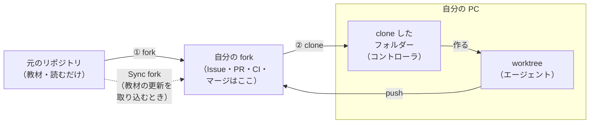
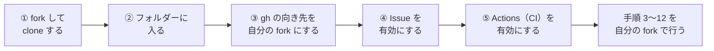

# ハンズオン: herdr と Claude Code で「コントローラ＋エージェント」の開発を回す

AI のセッションを 1 つだけ使うのではなく、**コントローラ 1 つ＋エージェント 2 つ**を herdr の画面に並べ、
GitHub の Issue と PR でつないで開発する流れを、AI Invaders への小さな変更 2 件で体験します。

```text
 人間 ──(Issue の内容・依頼)──▶ コントローラ ──(割当文)──▶ エージェント A ─┐
  ▲                              │                      エージェント B ─┤
  │                              ▼                                      ▼
  └──(報告)──── コントローラ ◀──(完了の報告)──── GitHub の Issue・PR・CI
  │
  └──(マージ)──▶ GitHub
```

- **人間**は、何を作るか（Issue の内容）を決め、最後に PR をマージするだけ。
- **コントローラ**は、Issue を作り、エージェントに 1 件ずつ割り当て、終わった PR を確かめて人間に報告する。自分では実装しない。
- **エージェント**は、割り当てられた Issue 1 件だけを、自分専用のフォルダー（git worktree）で実装し、PR を作る。

決まりの全体は [AGENTS.md](../../AGENTS.md) にあります。この手順書は、その決まりに沿って当日に行う操作を順に並べたものです。

## 手順の全体

| 手順 | 誰が | 何をするか | 目安 |
|---|---|---|---|
| [1](#1-事前に用意するもの) | 人間 | 道具がそろっているか確かめる | 前日 |
| [2](#2-リポジトリを手元に用意するclone) | 人間 | リポジトリを clone する | 2 分 |
| [3](#3-herdr-で画面を-3-つに分けclaude-code-を起動する) | 人間 | herdr で画面を 3 つに分け、Claude Code を 3 つ起動する | 5 分 |
| [4](#4-コントローラに役割を渡す) | 人間 → コントローラ | コントローラに役割を渡す | 1 分 |
| [5](#5-サンプルの-issue2-件を知る) | 人間 | 作る 2 件（サンプルの Issue）の中身を知る | 5 分 |
| [6](#6-コントローラに-issue-の作成を依頼する) | 人間 → コントローラ | Issue の作成を依頼する | 3 分 |
| [7](#7-棚卸しと割り当てを依頼する) | 人間 → コントローラ → エージェント | 棚卸しをさせ、割当文を確かめてから送らせる | 5 分 |
| [8](#8-エージェントの作業を見守る) | エージェント（人間は見守る） | 実装・検証・レビュー・PR の作成 | 10〜20 分 |
| [9](#9-完了の報告を受けて-pr-を確かめる) | コントローラ → 人間 | PR を確かめて報告する | 3 分 |
| [10](#10-pr-をマージする) | 人間 | PR をマージする | 2 分 |
| [11](#11-片付けを依頼する) | 人間 → コントローラ → エージェント | worktree とブランチを片付ける | 2 分 |
| [12](#12-できあがったゲームで遊ぶ) | 人間・受講者 | できあがったゲームで遊ぶ | 5 分 |

この手順書では、**人間が打つコマンド**は `bash` のブロック、**Claude Code の入力欄に貼り付ける文**は `text` のブロックで書いています。

---

## 1. 事前に用意するもの

| もの | 確かめ方 |
|---|---|
| herdr | `herdr --version` |
| Claude Code（ログイン済み） | `claude --version`（初回は `claude` を起動してログイン） |
| GitHub CLI（ログイン済み・このリポジトリに書込み権限） | `gh auth status` |
| git・Node.js 22 以上 | `git --version`・`node --version`（`tools/assign.sh` も Node.js で動く） |
| Docker（Windows は WSL 2 の Docker Engine・Mac は Colima など） | `docker compose version` |

**入れ方はすべてルートの README にあります**: Mac は [「Mac の事前準備」](../../README.md#mac-の事前準備)、
Windows は [「Windows の事前準備」](../../README.md#windows-の事前準備) の ① 〜 ④ をすべて行います。ここには入れ方を書きません。

- API キー（`.env`）は要らない。ゲームはブラウザの中だけで動き、外部のサービスを使わない。
- 前日に、この手順書の 2 〜 12 を一度通しておく（下の「時間の目安と、詰まったとき」）。

> **Windows の人へ**: 以降のコマンドは、すべて **Ubuntu の画面（スタートメニューの「Ubuntu」）** で打ちます。PowerShell は使いません。

---

## 2. リポジトリを手元に用意する（clone）

### 手順

```bash
# 1) 作業する場所へ移る（ホームの直下で行う例）
cd ~

# 2) GitHub からリポジトリを複製する
gh repo clone Challenge-Consulting-Firm/ai-dev-handson-invaders

# 3) できたフォルダーに入る
cd ai-dev-handson-invaders

# 4) 状態を確かめる
git status
```

`git status` が次のように出れば成功です。

```text
On branch main
Your branch is up to date with 'origin/main'.

nothing to commit, working tree clean
```

### 解説

- **clone（クローン）** は、GitHub にあるリポジトリを、履歴ごと手元のフォルダーに複製することです。以降の作業はすべてこのフォルダーで行います。
- `gh repo clone` は `git clone https://github.com/...` と同じ働きですが、`gh auth login` でログインした情報をそのまま使うので、パスワードを聞かれません。
- エージェントは、このフォルダーの**隣**に自分専用のフォルダー（`../ai-dev-handson-invaders-wt/…`）を作って作業します。そのため、clone する場所の 1 つ上のフォルダー（例ではホーム）にも書き込めるようにしておきます。
- Windows では、clone を **WSL 2 のホーム（`~/`）** に置きます。Windows 側（`/mnt/c/...`）に置くと、読み書きが遅く、改行の扱いも混ざりやすくなります。

### 受講者が自分で行うとき（fork）

上の手順は、このリポジトリに**書き込む権限がある人**（進行役）向けです。受講者が自分の手で同じ流れを体験するときは、
**fork（フォーク）** で自分のアカウントにリポジトリの複製を作り、その複製で行います。

#### fork の目的

- **書き込む権限が無くても、すべての操作を自分で体験できる**: このリポジトリは公開されていますが、受講者は Issue の作成・push・PR・マージができません。
  自分の fork なら、自分が持ち主なので、手順 3 〜 12 をすべて自分で行えます。
- **元のリポジトリを汚さない**: 受講者の Issue・ブランチ・PR は、すべて自分の fork の中にできます。教材（元のリポジトリ）は変わりません。
- **受講者どうしがぶつからない**: 全員が同じリポジトリで同じ Issue を作ると、番号もブランチ名も重なります。fork なら一人ひとりが別の場所で行えます。

#### 元のリポジトリ・fork・手元の関係



| 図の箱 | 場所 | 何をする所か |
|---|---|---|
| 元のリポジトリ | `Challenge-Consulting-Firm/ai-dev-handson-invaders` | 教材。受講者は読むだけで、何も送らない |
| 自分の fork | `<自分>/ai-dev-handson-invaders` | 自分専用の複製。Issue・PR・CI・マージはすべてここで行う |
| clone したフォルダー | 手元の `ai-dev-handson-invaders` | herdr とコントローラを起動する場所 |
| worktree | 手元の `../ai-dev-handson-invaders-wt/…` | エージェントが作業する専用のフォルダー。ここから自分の fork へ push する |

- `gh repo fork --clone` を使うと、①（fork）と ②（clone）が 1 回で済みます。
- 手元のフォルダーでは、**`origin` が自分の fork**、**`upstream` が元のリポジトリ**を指します。エージェントは `origin`（自分の fork）にだけ push します。
- 元のリポジトリには何も送りません（点線の「教材の更新を取り込む」向きだけ）。

#### 準備の流れ



#### 手順

```bash
# ① 自分のアカウントに fork し、そのまま手元に clone する
gh repo fork Challenge-Consulting-Firm/ai-dev-handson-invaders --clone

# ② できたフォルダーに入る
cd ai-dev-handson-invaders

# ③ gh の Issue・PR の向き先を、自分の fork にする
gh repo set-default <自分の GitHub ユーザー名>/ai-dev-handson-invaders

# ④ fork では Issue が最初は無効になっているので、有効にする
gh repo edit --enable-issues

# 確かめる: origin が自分の fork、upstream が元のリポジトリになっていればよい
git remote -v
```

⑤ fork した直後は自動チェック（CI）も止まっています。ブラウザで `https://github.com/<自分の GitHub ユーザー名>/ai-dev-handson-invaders/actions` を開き、
ワークフローを有効にするボタンを押します。

#### 解説

- **③ が大事**: fork の中で `gh issue create` や `gh pr create` を打つと、設定によっては**元のリポジトリ**に Issue や PR を作ろうとします。
  `gh repo set-default` で向き先を自分の fork に固定しておくと、コントローラとエージェントの `gh` のコマンドがすべて自分の fork に向きます。
- **PR の向き**: エージェントが作る PR は、「自分の fork の作業用ブランチ → 自分の fork の `main`」です。元のリポジトリへの PR は作りません。
  手順 9 で PR を開いたとき、画面の上に `<自分>/ai-dev-handson-invaders:main ← …` と出ていれば正しい向きです。
- **マージも自分で**: 手順 10 のマージは、fork の持ち主である自分が行います（`gh pr merge` も自分の fork に向く）。
- **教材が更新されたとき**: 元のリポジトリの新しい内容を取り込みたいときは、fork の画面の「Sync fork」を押すか、`gh repo sync <自分>/ai-dev-handson-invaders` を実行してから、手元で `git pull` します。

---

## 3. herdr で画面を 3 つに分け、Claude Code を起動する

### 手順

1. clone したフォルダーで herdr を起動します。

   ```bash
   herdr
   ```

2. herdr の画面を、次の形の 3 つのペインに分けます。起動した直後は、画面全体が 1 つのペイン（これが左のペインになる）です。

   ```text
   ┌──────────────────────┬──────────────────────┐
   │ controller           │ agent-a              │
   │ （コントローラ）     │ （サンプル A・画面）  │
   │                      ├──────────────────────┤
   │                      │ agent-b              │
   │                      │ （サンプル B・ルール）│
   └──────────────────────┴──────────────────────┘
   ```

   herdr の中のペイン（左のペイン）で、次を 1 行ずつ打ちます。

   ```bash
   # (1) 今のペインを左右に分ける（右側に新しいペインができる。入力は左のペインのまま）
   herdr pane split --current --direction right --cwd "$PWD" --no-focus
   ```

   1 行の長い文字列（JSON）が出ます。その中の **`"pane_id":"…"`** が、新しくできた**右のペインの ID** です。

   ```text
   {"id":"cli:pane:split","result":{"pane":{ … ,"pane_id":"w1:p2", … }}}
                                                ^^^^^^^^^^^^^^^^^ この w1:p2 が右のペインの ID
   ```

   ```bash
   # (2) 右のペインを上下に分ける（<右のペイン ID> は (1) の pane_id。例: w1:p2）
   herdr pane split --pane <右のペイン ID> --direction down --cwd "$PWD" --no-focus
   ```

   もう一度 JSON が出ます。今度の `"pane_id"` が**右下のペインの ID** です。(1) の ID は、そのまま**右上のペインの ID** として使います。

   ```bash
   # (3) 3 つになったことを確かめる（3 つの pane_id が出ればよい）
   herdr pane list
   ```

3. 同じく左のペインで、右上と右下に Claude Code を起動し、名前を付けます。

   ```bash
   herdr agent start agent-a --kind claude --pane <右上のペイン ID>   # 例: w1:p2
   herdr agent start agent-b --kind claude --pane <右下のペイン ID>   # 例: w1:p3
   ```

   それぞれ、右のペインで Claude Code が起動し、入力を待つ状態になると戻ってきます（最大 30 秒ほど）。

4. 最後に、左のペイン自身で Claude Code を起動します。これがコントローラになります。

   ```bash
   claude
   ```

5. コントローラの入力欄で、先頭に `!` を付けて次を打ち、左のペインに `controller` という名前を付けます（`!` を付けると、Claude Code の中からそのままコマンドを実行できる）。

   ```text
   ! herdr agent rename "$HERDR_PANE_ID" controller
   ! herdr agent list
   ```

   `$HERDR_PANE_ID` には、herdr が「今いるペインの ID」を自動で入れてくれるので、ID を書き写す必要はありません。
   `herdr agent list` に `controller`・`agent-a`・`agent-b` の 3 つが出れば準備完了です。

### 解説

- **herdr** は、1 つのターミナルの中に複数の画面（ペイン）を並べ、その中で動く AI のセッションに**名前を付けて、互いに文を送れるようにする**道具です。コントローラは `agent-a` という名前を使ってエージェントに割当文を送り、エージェントは `controller` という名前で完了を報告します。
- **ペインを分けるコマンドの意味**: `--current` は「今いるペインを分ける」、`--pane <ID>` は「その ID のペインを分ける」、`--direction right`／`down` は分ける向き（右に足す／下に足す）です。
  `--cwd "$PWD"` は、新しいペインを今と同じフォルダー（clone したフォルダー）で開くため、`--no-focus` は、入力を左のペインに残したまま続けて打てるようにするためです。
- **ペイン ID**（`w1:p2` など）は、herdr が付ける各ペインの番号です。コマンドの結果から読み取って使います。人によって数字が違うので、例の値をそのまま打たないでください。
- `herdr agent start` は、相手のペインがシェルの入力待ちのときだけ使えます。自分自身のペインには使えないため、コントローラだけはこの手順の 4 で直接 `claude` を起動し、5 で名前を付けています。
- 3 つとも同じフォルダー（clone したフォルダー）で起動します。エージェントは、割り当てを受けてから自分専用のフォルダーを作り、そちらへ移って作業します。
- Claude Code は起動すると、このリポジトリの `CLAUDE.md` と `AGENTS.md` を自動で読みます。役割・開発の流れ・してはいけないこと（マージをしない・`.env` を読まないなど）は、そこに書いてあります。

### TIPS: herdr を使う利点（異なるエージェントを 1 つのハーネスにまとめられる）

複数の AI エージェントに役割を分けて動かす仕組み（**ハーネス**）は、herdr を使わなくても組めます。
たとえば Claude Code には、1 つのセッションの中から別のエージェント（サブエージェント）を呼び出して仕事を任せる仕組みがあります。
ただしこの形では、**同じツールのエージェントどうし**でしかチームを組めません。

herdr は、ターミナルの画面（ペイン）の単位でエージェントを並べ、名前を付けて互いに文を送れるようにします。
そのため、**種類の違うエージェントを 1 つのハーネスにまとめられる**のが利点です。

```text
 1 つのツールの中で組むハーネス           herdr で組むハーネス
┌──────────────────────────┐        ┌───────────┬───────────────┐
│ Claude Code              │        │ controller│ agent-a       │
│  ├─ サブエージェント 1    │        │ Claude    │ Claude Code   │
│  └─ サブエージェント 2    │        │ Code      ├───────────────┤
│ （すべて同じツール）      │        │           │ agent-b       │
└──────────────────────────┘        │           │ Codex など    │
                                    └───────────┴───────────────┘
                                     （ツールの種類を混ぜられる）
```

- **得意なものを組み合わせられる**: たとえば、コントローラと画面の変更は Claude Code、ルールとテストの変更は Codex、のように役割ごとに選べます。
- **やり取りの形は同じ**: どのエージェントにも、`herdr agent prompt` で割当文を送り、`herdr agent read` で画面を読み、`herdr agent list` で状態（入力待ち・作業中・確認待ち）を見る、という同じ操作で指示と確認ができます。
- **人が途中の様子を見られる**: 各エージェントが自分のペインで動くので、何をしているかを画面で見られ、確認の画面にも人が直接答えられます。

起動するときは、`--kind` でエージェントの種類を指定します（指定できる種類は `herdr agent start --help` で確かめる）。たとえば agent-b を Codex にするなら次のとおりです。

```bash
herdr agent start agent-b --kind codex --pane <右下のペイン ID>
```

> **混ぜるときの注意**: このリポジトリの決まりは、Claude Code 以外のエージェントも読めるように `AGENTS.md` に書いてあります（Claude Code は `CLAUDE.md` から読み込む）。
> 一方、確認なしで動かすコマンドの許可（`.claude/settings.json`）は Claude Code だけの設定です。ほかのエージェントでは、そのエージェント自身の設定で権限を決めてください。
> また、手順 8 のレビューは `claude -p` を使うので、どのエージェントを使う場合でも Claude Code は入れておきます。
> 割当文を送る `tools/assign.sh` は、送る前に Claude Code のコマンド（`/clear`・`/compact`）を相手に送ります。Claude Code 以外のエージェントに送るときは、3 つ目の引数を `none` にし（`bash tools/assign.sh agent-b none <割当文のファイル>`）、前の会話の消し方はそのエージェントのやり方で行います。
> このハンズオンの手順は Claude Code 3 つで確かめる前提で書いています。混ぜる場合は、前日の通し稽古で同じ組み合わせを試してください。

---

## 4. コントローラに役割を渡す

### 手順

コントローラ（左のペイン）の入力欄に、次の文を貼り付けて送ります。

```text
あなたはこのリポジトリのコントローラです。docs/handson/controller-prompt.md を読み、その内容に従ってください。
エージェントは herdr の名前で agent-a と agent-b の 2 つです。あなたの名前は controller です。
読み終わったら、自分の役割を 3 行でまとめて返し、私の次の指示を待ってください。まだ何も実行しないでください。
```

コントローラが「実装しない・マージしない・Issue を作る・割り当てる・確かめて報告する」といった内容で役割をまとめて返せば、次へ進みます。

### 解説

- [`controller-prompt.md`](controller-prompt.md) は、コントローラの仕事の手順書です（Issue の作り方・棚卸し・割り当て・完了の確かめ方）。長い文を毎回貼り付ける代わりに、ファイルを読ませています。
- 「役割をまとめて返す」「まだ何も実行しない」と頼むのは、**理解したかを人間が先に確かめる**ためです。AI に仕事を渡すときは、動き出す前に一度、理解の中身を言葉で返させると、ずれに早く気付けます。
- エージェント（右の 2 つ）には、この時点では何も送りません。割当文はコントローラが送ります。

---

## 5. サンプルの Issue（2 件）を知る

今回作るのは次の 2 件です。どちらも、今の AI Invaders に足りないところを補う小さな変更です。

| | サンプル A: ハイスコア | サンプル B: 次の面 |
|---|---|---|
| 何を変えるか | ハイスコアをブラウザに保存し、画面の上の中央に `HI 00310` の形で出す | 敵を全部倒したら、スコアと残機を持ったまま次の面へ進む。面が進むほど敵が速くなる |
| 今の困りごと | ゲームオーバーでスコアが消え、前の記録と比べられない | 全部倒すと「CLEAR!」で終わり、続けて遊べない |
| 触るファイル | `src/render.ts`・`src/main.ts`・新しい `src/highscore.ts`（**画面の側**） | `src/game/` 配下だけ（**ルールの側**） |
| 確かめ方 | ブラウザで遊んで、ハイスコアの更新と、再読み込みで残ることを見る | `npm test` のテストで確かめる（**先にテストを書く**） |
| 担当 | agent-a | agent-b |

### 解説（なぜこの 2 件か）

- **触るファイルが重ならない**: AI Invaders は、ゲームのルール（`src/game/`）と、画面に描く部分（`src/render.ts`）を分けて作っています（ルートの README の「ゲームが動くしくみ」）。A は画面の側、B はルールの側だけを触るので、**2 つのエージェントが同時に作業してもぶつかりません**。
- **確かめ方が違う**: A は画面の変更なので、ブラウザで実際に遊んで確かめます。B はルールの変更なので、テストで確かめます。AI に任せるときの「確かめ方」の 2 つの型を、並べて見られます。
- **Issue の型**: どちらも「目的・変更する範囲・受入条件・やらないこと」の 4 つで書いています（ひな形: [`.github/ISSUE_TEMPLATE/change.md`](../../.github/ISSUE_TEMPLATE/change.md)）。特に **「やらないこと」** に、もう一方が触るファイルを書いておくのが要です。AI は頼まれていない所まで「ついでに」直しがちなので、範囲の外を言葉で止めます。

---

## 6. コントローラに Issue の作成を依頼する

### 手順

Issue の**内容は人間が決め、GitHub に作るのはコントローラ**に任せます。次の 2 つの文を、**1 つずつ**コントローラに貼り付けて送ります。
コントローラが Issue の番号と URL を返したら、次の文を送ります。

**依頼 A（ハイスコア）**

````text
【人間→controller 依頼】次の題名と本文で、GitHub に Issue を 1 件作ってください。本文は一字も変えずにそのまま使ってください。作ったら Issue の番号と URL を返してください。

題名: AI Invaders: ハイスコアを保存して画面に出す

本文:
## 目的

AI Invaders は、ゲームオーバーになるとスコアが消えてしまい、前の自分の記録と比べられません。
**ハイスコア**をブラウザに保存し、画面の上に出して、もう一度遊ぶ動機を作ります。

## 変更する範囲

- `apps/invaders/src/render.ts`（画面上部の表示）
- `apps/invaders/src/main.ts`（ゲームオーバー／クリアになったときにハイスコアを更新する）
- 新しいファイル `apps/invaders/src/highscore.ts`（ブラウザの `localStorage` への読み書き）

## 受入条件

- [ ] 画面上部の中央に `HI 00310` の形（5 桁・0 埋め）でハイスコアが出る
- [ ] ゲームオーバーまたはクリアになったとき、今回のスコアがハイスコアより高ければ更新される
- [ ] ページを再読み込みしても、ハイスコアが残っている
- [ ] `localStorage` が使えないブラウザ（プライベートブラウズなど）でも、ゲームは止まらずに遊べる（ハイスコアは 0 のまま）
- [ ] `npm run typecheck`・`npm test`・`npm run build` が通る
- [ ] ブラウザで 1 回遊んでハイスコアが更新されること・再読み込みで残ることを確かめる（スクリーンショットを PR に貼る）

## やらないこと

- ゲームのルール（`apps/invaders/src/game/` 配下）の変更（同時に別の Issue が「次の面」を足すため）
- ハイスコアのランキング（複数件）や名前の入力
- `package.json` の変更（新しいライブラリは入れない）
````

**依頼 B（次の面）**

````text
【人間→controller 依頼】次の題名と本文で、GitHub に Issue を 1 件作ってください。本文は一字も変えずにそのまま使ってください。作ったら Issue の番号と URL を返してください。

題名: AI Invaders: 敵を全部倒したら次の面に進む

本文:
## 目的

AI Invaders は、敵を全部倒すと「CLEAR!」で終わり、もう一度遊ぶと最初の面・スコア 0 に戻ってしまいます。
**次の面（ウェーブ）に進み、面が進むほど敵が速くなる**ようにして、続けて遊べるようにします。

## 変更する範囲

- `apps/invaders/src/game/` 配下だけ（`game.ts`・`types.ts`・`config.ts`・`game.test.ts`）
  （`step()` は画面に触らない純粋な関数なので、ルールの変更はテストで確かめられる）

## 受入条件

- [ ] `GameState` に今の面の番号 `wave`（1 から始まる）がある
- [ ] 状態が `clear` のときに start の入力が来ると、**スコアと残機はそのまま**で、`wave` が 1 増え、敵の隊列が最初の位置に並び直して `playing` になる
- [ ] 状態が `over` のときに start の入力が来ると、今までどおり最初から（面 1・スコア 0）始まる
- [ ] 隊列の横の速さが、面ごとに 1.2 倍ずつ速くなる（面 1 は今と同じ速さ。倍率は `config.ts` に置く）
- [ ] 上の 4 つを確かめるテストが `game.test.ts` にあり、`npm test`・`npm run typecheck`・`npm run build` が通る

## やらないこと

- 画面（`src/render.ts`・`src/main.ts`）の変更。面の番号を画面に出すこと・「CLEAR!」の文言を変えることは、別の Issue にする
  （同時に別の Issue がハイスコアの表示で `render.ts` と `main.ts` を触るため）
- 敵の弾の速さや間隔など、受入条件にない数値の変更。気になる所を見つけたら、**直さずにこの Issue へコメント**で書く
````

2 件とも作られたら、返ってきた URL をブラウザで開き、題名と本文が依頼どおりかを確かめます。**2 つの Issue の番号を控えておきます**（以降、`#<A>`・`#<B>` と書く所に入れる）。

### 解説

- **人間が決めるのは中身、作業は AI**: 何を作るか・どこまでで完了とするか（受入条件）・何をしないかは、人間が決めます。GitHub に Issue を作る操作（`gh issue create`）はコントローラに任せます。
- 「本文は一字も変えずに」と書いているのは、AI が気を利かせて文を書き換えたり、受入条件を足したりしないようにするためです。Issue はエージェントにとって**完成の基準**なので、人間が決めた文のまま残します。
- 1 件ずつ送るのは、1 件目の結果（番号・URL）を確かめてから次へ進むためです。まとめて送ると、片方が失敗したときに気付きにくくなります。
- 件名の `【人間→controller 依頼】` は、[AGENTS.md の「報告の型」](../../AGENTS.md#報告の型herdr-でセッション間に送る)と同じ形です。誰から誰への、何の文かが 1 行目で分かります。

---

## 7. 棚卸しと割り当てを依頼する

### 手順

1. コントローラに、次の文を送ります（`#<A>`・`#<B>` は手順 6 の番号に置き換える）。

   ```text
   【人間→controller 依頼】棚卸しをして、表で見せてください。
   そのうえで、Issue #<A> を agent-a に、Issue #<B> を agent-b に割り当てる割当文を、docs/handson/assign-examples.md の型で作ってください。
   送る前に、2 つの割当文の全文を私に見せて、承認を待ってください。
   ```

2. コントローラが出す**棚卸しの表**（エージェント × 担当の Issue／PR × ブランチ × 状態）を見ます。今はどのエージェントも何も持っていないはずです。

3. コントローラが出す**2 つの割当文**を読み、次を確かめます。
   - Issue の番号が合っている
   - 「ほかのエージェントが触る場所」に、相手のファイルが名指しで書かれている（A の割当文に `src/game/`、B の割当文に `src/render.ts`・`src/main.ts`・`src/highscore.ts`）
   - 作業場所（ブランチ名・`../ai-dev-handson-invaders-wt/…`）が 2 つで別々になっている

4. 問題が無ければ、承認を送ります。

   ```text
   承認します。2 つの割当文を送ってください。
   ```

   コントローラが `bash tools/assign.sh agent-a clear …` と `bash tools/assign.sh agent-b clear …` を実行し、右の 2 つのペインに割当文が届きます。

### 解説

- **棚卸しを先に行う理由**: 誰が何を持っているかを確かめずに割り当てると、同じファイルを 2 人が触ったり、終わっていない仕事に次の仕事を重ねたりします。人間のチームと同じく、割り当ての前に「今の状態」を表で見ます。
- **割当文の 8 項目**（[`assign-examples.md`](assign-examples.md)）: 誰の指示か・Issue・やること・やらないこと・ほかのエージェントが触る場所・作業場所・PR の形・終わったら報告して待機。エージェントは割当文だけを頼りに動くので、**欠けている項目は推測で埋められてしまいます**。
- **送る前に人間が読む**: 割当文は、AI に渡す「仕事の指示書」です。ここで人間が一度読むことで、範囲の取り違えを作業の前に止められます。
- `tools/assign.sh` は、相手が入力待ちかを確かめ、`/clear` で前の会話を消してから割当文を送ります。前の仕事の文脈を持ち込ませないためです。

---

## 8. エージェントの作業を見守る

### 手順

右の 2 つのペインで、エージェントが次の順に作業を進めます（[AGENTS.md の「開発の流れ」](../../AGENTS.md#開発の流れすべての変更で守る) の 3 〜 7）。

1. 最新の `origin/main` から作業用のブランチと worktree（専用のフォルダー）を作り、GitHub へ push する
2. `apps/invaders` で `npm ci` → 実装 → `npm run typecheck`・`npm test`・`npm run build`
3. agent-a はブラウザで遊んで確かめる（開発サーバー: http://localhost:5173）。agent-b はテストで確かめる
4. 変更をコミットして push し、別の Claude（`claude -p`）に差分をレビューさせ、指摘と「直した／直さない＋理由」を Issue にコメントする
5. PR を作り、自動チェック（CI）が緑になるのを確かめて、コントローラに完了を報告する

人間が行うのは、**確認の画面に答えること**だけです。ペインに許可を求める画面が出たら、中身を読んでから許可するか断ります。

| よく出る確認 | 見る所 |
|---|---|
| `git push …` | 押し先のブランチが、割当文のブランチ名か（`main` への push は断る） |
| `npm run dev`（開発サーバーの起動） | agent-a だけが起動しているか（agent-b は起動しない約束） |
| `git worktree add …` | 作業場所が `../ai-dev-handson-invaders-wt/…` か |

エージェントの画面が止まって見えるときは、コントローラのペインで次を打って、最後の 40 行を読みます。

```text
! herdr agent read agent-a --lines 40
```

### 解説

- **worktree（ワークツリー）** は、1 つのリポジトリから、ブランチごとに別のフォルダーを作る git の機能です。2 つのエージェントが同じフォルダーで作業すると、互いの変更が混ざります。フォルダーを分けることで、**同時に作業しても混ざりません**。
- **作った直後に push する**のは、途中で PC やセッションが止まっても、作業の場所を GitHub に残しておくためです。
- **別の Claude にレビューさせる**のは、書いた本人（同じ会話の AI）は自分の思い込みに気付きにくいからです。差分と Issue だけを見せた新しい Claude に、受入条件の漏れやバグを指摘させます。その結果と対応を Issue に残すので、後から人間が判断の理由を追えます。
- **確認の画面は「人間が見る所」**: `.claude/settings.json` で、型検査・テスト・Issue と PR の作成などは確認なしで動くようにしてあります。push・開発サーバーの起動・依存の追加などは、**わざと毎回確認が出る**ようにしてあります。外に影響が出る操作だけを、人間が止められるようにするためです。中身を読まずに許可しないでください。

---

## 9. 完了の報告を受けて PR を確かめる

### 手順

1. エージェントが終わると、コントローラのペインに次のような報告が届きます。

   ```text
   【agent-a→controller 完了】PR #… を作成しました。CI 緑。レビューの指摘 3 件（直した 2・直さない 1）は Issue #… に記録。待機します。
   ```

2. コントローラは、届いた報告を受けて PR を確かめ（`Closes` が 1 件だけ・変えたファイルが割当の範囲内・CI が緑・レビューの記録が Issue にある）、人間に報告します。
   報告が来ないときは、次を送ります。

   ```text
   【人間→controller 依頼】agent-a と agent-b の PR を確かめて、PR 番号・CI・変えたファイルの範囲・残っていることを報告してください。
   ```

3. 人間は、報告にある PR の URL をブラウザで開き、次を見ます。
   - **Files changed**: 変えたファイルが、Issue の「変更する範囲」に収まっているか
   - **Checks**: 自動チェックが緑か
   - Issue のコメント: レビューの指摘と「直した／直さない＋理由」が残っているか
   - サンプル A の PR: ハイスコアのスクリーンショットが貼られているか

### 解説

- **人間が見るのは「報告と PR」だけでよい**: コントローラが範囲・CI・記録を先に確かめているので、人間はエージェントの作業の途中を逐一見なくても判断できます。これが、AI を複数並べても人間の手が増えない理由です。
- **`Closes #…` を 1 件だけ**: PR の本文にこう書くと、マージしたときに Issue が自動で閉じます。1 つの PR が 1 つの Issue だけを閉じるようにして、「何のための変更か」を 1 対 1 に保ちます。

---

## 10. PR をマージする

### 手順

マージは**人間だけ**が行います。報告と PR の中身に問題が無ければ、PR を 1 つずつマージします。

```bash
gh pr merge <PR 番号> --squash --delete-branch
```

（ブラウザで PR を開き、「Squash and merge」を押してもよい）

2 つの PR は触るファイルが重ならないので、どちらを先にマージしても構いません。

### 解説

- **マージを人間に残す理由**: マージは、変更を「正しいもの」として main に入れる最終判断です。AI はマージしない決まり（[AGENTS.md の「してはいけないこと」](../../AGENTS.md#してはいけないこと)）にし、Claude Code の設定でも `gh pr merge` を禁止しています。
- `--squash` は、PR の中の複数のコミットを 1 つにまとめて main に入れます。main の履歴が「1 つの Issue = 1 つのコミット」になり、読みやすくなります。
- `--delete-branch` は、マージした作業用のブランチを GitHub から消します。

---

## 11. 片付けを依頼する

### 手順

コントローラに次を送ります。

```text
【人間→controller 依頼】PR #… と PR #… をマージしました。MERGED を確かめてから、agent-a と agent-b に worktree とブランチの片付けを指示してください。終わったら報告してください。
```

コントローラが `gh pr view <PR 番号> --json state` で `MERGED` を確かめ、各エージェントに片付けの指示（[`assign-examples.md`](assign-examples.md) の最後の例）を送ります。

### 解説

- worktree は、作業が終わっても自動では消えません。エージェントが自分の worktree とブランチを消すことで、次の仕事を同じ名前で始めても混ざらないようにします。
- 「`MERGED` を確かめてから」としているのは、マージされていない作業を消してしまわないためです。

---

## 12. できあがったゲームで遊ぶ

### 手順

clone したフォルダー（`ai-dev-handson-invaders`）で、最新の main を取り込み、コンテナで起動します。

```bash
git switch main
git pull
docker compose up --build
```

ブラウザで http://localhost:8080 を開き、次を確かめます。

- 画面の上の中央に `HI 00000` が出ている → 1 回遊んでゲームオーバーになると、ハイスコアが更新される → ページを再読み込みしても残っている（サンプル A）
- 敵を全部倒して「CLEAR!」のあとに Enter を押すと、スコアと残機を持ったまま次の面が始まり、敵が少し速くなっている（サンプル B）

止めるときは `Ctrl+C` です。

### 解説

- `git pull` で、GitHub の main（2 つの PR がマージされた状態）を手元に取り込みます。エージェントは別のフォルダー（worktree）で作業していたので、clone したフォルダーはまだ古いままです。
- 2 つのエージェントが**別々に、同時に**作った変更が、1 つのゲームの中で両方動いていれば成功です。
- 「CLEAR!」の下の文が「もう一度」のままになっている、面の番号が画面に出ていない、といった点は、サンプル B の「やらないこと」で別の Issue に回したものです。**次の Issue の題材**として、受講者に書いてもらうのに使えます。

---

## 時間の目安と、詰まったとき

- エージェントの実装からレビュー・PR までは、1 件 10〜20 分かかることがある。並行で進めている間に、
  Issue の書き方・割当文・`AGENTS.md`・`.claude/settings.json` を説明する。
- 当日に間に合わない場合に備え、**前日に同じ流れを 1 回通した記録**（Issue・PR・画面の写し）を用意し、
  「事前に行った記録」と「当日その場で行っていること」を分けて見せる。
- エージェントが止まったときは、まず画面を読む: `herdr agent read agent-a --lines 40`。
  権限の確認で止まっているなら、人間が内容を見て許可するか断る（中身を読まずに許可しない）。
- エージェントが割当文に無いことを推測で進めず、`【… 質問】` を返してきたときは、人間が答えを決めてコントローラに伝える。

## もう一度行うとき

- 前回のハンズオンで作った Issue と PR は GitHub に残ります。同じ 2 件をもう一度行うときは、main を元に戻す PR を作ってから行うか、
  受講者ごとに fork（手順 2 の「受講者が自分で行うとき（fork）」）して、それぞれの fork で行います。
